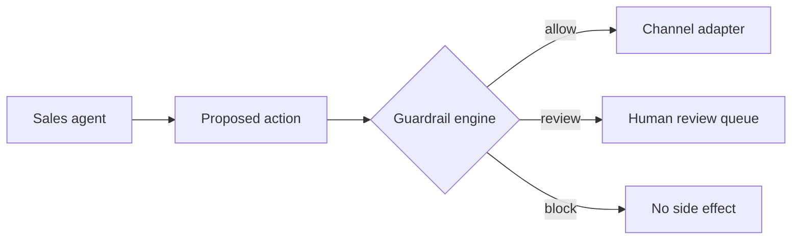

# VendaOS Guardrails

[Português (Brasil)](README.pt-BR.md)

VendaOS Guardrails is a deterministic, fail-closed policy layer for sales agents. It evaluates a proposed outbound action before a channel adapter sends it and returns one of three decisions: `allow`, `review`, or `block`.

The project is deliberately independent from any model provider, CRM, messaging vendor, or proprietary VendaOS service. It contains no customer data and has no production dependencies.

> **Status: experimental v0.2.0.** The Brazilian Portuguese preset is a conservative starting point, not a legal determination, compliance certification, or replacement for qualified counsel. Do not deploy it unchanged in a regulated or production flow.

## Why this exists

An AI agent should not decide by itself whether consent exists, whether a discount is authorized, or whether a risky claim may be sent. VendaOS Guardrails places a small deterministic boundary between agent output and external side effects.



The host application remains responsible for authentication, authoritative consent and contact history, durable audit storage, authorization of reviewers, replay prevention, and the final send operation.

## Included rules

| Rule | Default result when unsafe | Purpose |
|---|---:|---|
| Consent and opt-out | `block` | Stops promotional contact after opt-out or without a recorded grant |
| Local contact window | `block` | Uses the customer's IANA time zone and configured weekly hours |
| Frequency cap | `block` | Counts authoritative promotional contact history in a rolling window |
| Discount authority | `review` / `block` | Reviews discounts over automatic authority and blocks a hard limit |
| Opt-out instruction | `block` | Requires configured opt-out wording in written promotions |
| Sensitive data | `review` / `block` | Reviews CPF, CNPJ, or payment-card patterns and blocks apparent credentials |
| Restricted claims | `review` | Routes configured guarantees and high-risk claims to a person |

Every rule is configurable or replaceable. A rule exception is converted to `block` by default. A signed human approval can convert only `review` to `allow`; it can never override `block`.

## Run from source

The npm package has not been published. Use the tagged source release:

```bash
git clone https://github.com/huenri/vendaos-guardrails.git
cd vendaos-guardrails
npm ci --ignore-scripts
npm run check
```

Requirements: Node.js 22 or newer and npm with lockfile support.

## Quick start

Build the package with `npm run build`, then:

```js
import {
  createBrazilianPortuguesePolicy,
  GuardrailEngine,
} from "vendaos-guardrails";

const engine = new GuardrailEngine({
  policyVersion: "my-policy-2026-08",
  rules: createBrazilianPortuguesePolicy({
    maximumContacts: 3,
    rollingWindowHours: 24,
    maximumAutomaticDiscountPercent: 15,
    discountHardLimitPercent: 50,
  }),
});

const evaluation = await engine.evaluate({
  id: "action-001",
  customer: {
    id: "pseudonymous-customer-id",
    timezone: "America/Sao_Paulo",
    locale: "pt-BR",
    consent: { whatsapp: { marketing: { status: "granted" } } },
    optedOutChannels: [],
  },
  channel: "whatsapp",
  purpose: "marketing",
  content: "Olá! Temos uma condição especial. Responda SAIR para parar de receber.",
  scheduledAt: "2026-08-10T13:00:00.000Z",
  contactHistory: [],
  offer: { discountPercent: 10 },
});

if (evaluation.decision === "allow") {
  // The host may now call its authenticated channel adapter.
} else if (evaluation.decision === "review") {
  // Send the exact proposed action to an authenticated human review queue.
} else {
  // Do not perform the side effect.
}
```

See [`examples/quickstart.mjs`](examples/quickstart.mjs) for a runnable example.

## Untrusted runtime input

TypeScript types do not validate JSON received from an agent, webhook, queue, or API. Use
`parseSalesActionJson`, `parseSalesAction`, or `engine.evaluateUnknown` at that boundary. The
adapter rebuilds a fresh allow-listed object, rejects unknown fields by default, refuses accessors
and non-plain objects, bounds input, and returns minimized issues that do not echo rejected values.

```js
const evaluation = await engine.evaluateUnknown(JSON.parse(requestBody));
if (evaluation.decision !== "allow") {
  // Do not enqueue or send the action.
}
```

`SALES_ACTION_JSON_SCHEMA` is exported for gateways that already use a JSON Schema validator. The
package adapter remains authoritative because it also applies semantic checks such as IANA time
zones and explicit timestamp offsets.

## Exact-action human approval

Approval tokens use HMAC-SHA-256, expire quickly, and are bound to the policy version, action fingerprint, and selected rule IDs. The fingerprint covers hashed action and customer references, channel, purpose, schedule, message content, commercial terms, time zone, purpose-scoped permission, opt-out state, and contact history.

The approval secret must stay in an authenticated server-side review service and contain at least 32 bytes. Never expose it to an AI agent, browser, mobile client, logs, or a repository.

```js
import { createActionFingerprint, issueApproval } from "vendaos-guardrails";

const approval = issueApproval(
  {
    actionFingerprint: createActionFingerprint(proposedAction),
    policyVersion: "my-policy-2026-08",
    ruleIds: ["commercial.discount-authority"],
    approvedBy: authenticatedReviewerId,
  },
  process.env.VENDAOS_APPROVAL_SECRET,
);
```

For replay prevention, configure an `ApprovalNonceConsumer` whose `consume` operation is atomic
across every process that can authorize a send. A database unique constraint or compare-and-set is
appropriate; an in-memory set is not sufficient for production. The engine consumes the nonce only
when the approval can change the final result, and replay or storage failure remains `review`.

```js
const engine = new GuardrailEngine({
  policyVersion: "my-policy-2026-08",
  rules,
  approvalSecret,
  approvalNonceConsumer: {
    async consume({ nonce, expiresAt }) {
      return database.insertNonceIfAbsent({ nonce, expiresAt });
    },
  },
});
```

`engine.getPolicyManifest()` returns a deterministic machine-readable description of rule order,
limits, failure mode, and replay posture. It never includes executable rule functions or secrets.

## Privacy-preserving audit records

`createAuditRecord` stores rule decisions, codes, hashes, and a previous-record hash. It does not store message content or direct customer/action identifiers. `verifyAuditChain` detects modification or reordering of an in-memory chain.

This is tamper-evidence, not secure storage. Persist records in an access-controlled, append-only system with retention and deletion rules appropriate to your use case.

## Security properties and limits

- No production dependencies.
- Strict TypeScript and bounded message input.
- Runtime parsing for untrusted JSON-shaped input with strict unknown-field handling.
- Fail-closed rule execution by default.
- HMAC approvals cannot override a block.
- Optional atomic nonce consumption fails closed on replay or storage errors.
- Audit output excludes raw message content and direct identifiers.
- GitHub Actions are pinned to complete commit SHAs.
- CI tests Node.js 22 and 24; CodeQL and dependency review run separately.

This library cannot verify that the host supplied truthful consent, complete history, a correctly authenticated reviewer, or current legal configuration. Pattern detection can have false positives and false negatives. Read the [threat model](docs/THREAT_MODEL.md) before integrating it.

For a race-safe integration shape, see
[`examples/race-safe-outbox.mjs`](examples/race-safe-outbox.mjs) and
[`docs/OUTBOX_PATTERN.md`](docs/OUTBOX_PATTERN.md).

## Development

```bash
npm ci --ignore-scripts
npm test
npm run typecheck
npm run check
```

The tests use synthetic data only. Contributions are welcome; read [CONTRIBUTING.md](CONTRIBUTING.md), [SECURITY.md](SECURITY.md), and [GOVERNANCE.md](GOVERNANCE.md).

## License

Apache License 2.0. See [LICENSE](LICENSE) and [NOTICE](NOTICE).
