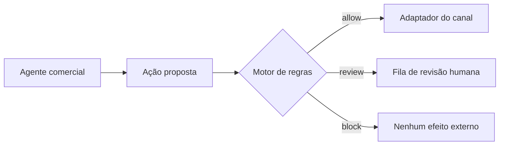

# VendaOS Guardrails

[English](README.md)

VendaOS Guardrails é uma camada determinística e *fail-closed* para agentes comerciais. Ela avalia uma ação de saída antes de o adaptador de canal enviá-la e devolve uma entre três decisões: `allow` (permitir), `review` (revisar) ou `block` (bloquear).

O projeto é deliberadamente independente de provedor de IA, CRM, canal de mensagens e serviços proprietários do VendaOS. Ele não contém dados de clientes e não possui dependências de produção.

> **Estado: v0.2.0 experimental.** O preset em português brasileiro é um ponto de partida conservador, não um parecer jurídico, certificação de conformidade ou substituto para assessoria qualificada. Não o coloque em produção sem adaptar e revisar.

## Por que este projeto existe

Um agente de IA não deveria decidir sozinho se há consentimento, se um desconto foi autorizado ou se uma alegação arriscada pode ser enviada. O VendaOS Guardrails cria uma fronteira pequena e determinística entre a saída do agente e efeitos externos.



A aplicação hospedeira continua responsável por autenticação, consentimento e histórico autoritativos, armazenamento durável de auditoria, autorização dos revisores, prevenção de replay e envio final.

## Regras incluídas

| Regra | Resultado inseguro padrão | Função |
|---|---:|---|
| Consentimento e opt-out | `block` | Impede promoção após opt-out ou sem concessão registrada |
| Janela local de contato | `block` | Usa fuso IANA do cliente e horários semanais configurados |
| Limite de frequência | `block` | Conta o histórico promocional autoritativo em uma janela móvel |
| Autoridade de desconto | `review` / `block` | Revisa desconto acima da autonomia e bloqueia o limite absoluto |
| Instrução de opt-out | `block` | Exige texto configurado para sair de promoções escritas |
| Dados sensíveis | `review` / `block` | Revisa padrões de CPF, CNPJ e cartão e bloqueia possíveis credenciais |
| Alegações restritas | `review` | Encaminha garantias e alegações de risco configuradas para uma pessoa |

Toda regra pode ser configurada ou substituída. Uma exceção interna vira `block` por padrão. Uma aprovação humana assinada pode transformar somente `review` em `allow`; jamais remove um `block`.

## Executar a partir do código-fonte

O pacote npm ainda não foi publicado. Use a versão marcada no código-fonte:

```bash
git clone https://github.com/huenri/vendaos-guardrails.git
cd vendaos-guardrails
npm ci --ignore-scripts
npm run check
```

Requisitos: Node.js 22 ou mais recente e npm com suporte a lockfile.

## Uso básico

Depois de `npm run build`:

```js
import {
  createBrazilianPortuguesePolicy,
  GuardrailEngine,
} from "vendaos-guardrails";

const engine = new GuardrailEngine({
  policyVersion: "minha-politica-2026-08",
  rules: createBrazilianPortuguesePolicy({
    maximumContacts: 3,
    rollingWindowHours: 24,
    maximumAutomaticDiscountPercent: 15,
    discountHardLimitPercent: 50,
  }),
});

const avaliacao = await engine.evaluate({
  id: "acao-001",
  customer: {
    id: "identificador-pseudonimo",
    timezone: "America/Sao_Paulo",
    locale: "pt-BR",
    consent: { whatsapp: { marketing: { status: "granted" } } },
    optedOutChannels: [],
  },
  channel: "whatsapp",
  purpose: "marketing",
  content: "Olá! Temos uma condição especial. Responda SAIR para parar de receber.",
  scheduledAt: "2026-08-10T13:00:00.000Z",
  contactHistory: [],
  offer: { discountPercent: 10 },
});

if (avaliacao.decision === "allow") {
  // A aplicação pode chamar seu adaptador de canal autenticado.
} else if (avaliacao.decision === "review") {
  // Envie a ação exata para uma fila humana autenticada.
} else {
  // Não realize o efeito externo.
}
```

Veja [`examples/quickstart.mjs`](examples/quickstart.mjs).

## Entrada não confiável em runtime

Os tipos do TypeScript não validam JSON recebido de agente, webhook, fila ou API. Use
`parseSalesActionJson`, `parseSalesAction` ou `engine.evaluateUnknown` nessa fronteira. O adaptador
reconstrói um objeto novo somente com campos permitidos, rejeita campos desconhecidos por padrão,
recusa getters e objetos não simples, limita a entrada e devolve erros minimizados sem repetir os
valores rejeitados.

```js
const avaliacao = await engine.evaluateUnknown(JSON.parse(corpoDaRequisicao));
if (avaliacao.decision !== "allow") {
  // Não coloque a ação na fila e não envie.
}
```

`SALES_ACTION_JSON_SCHEMA` também é exportado para gateways que já usam JSON Schema. O adaptador da
biblioteca continua autoritativo porque aplica validações semânticas, como fuso IANA e timestamps
com offset explícito.

## Aprovação humana vinculada à ação

Os tokens usam HMAC-SHA-256, expiram rapidamente e ficam vinculados à versão da política, ao fingerprint da ação e às regras selecionadas. O fingerprint cobre referências transformadas por hash, canal, finalidade, horário, conteúdo, termos comerciais, fuso, permissão por finalidade, opt-out e histórico de contato.

O segredo de aprovação precisa permanecer em um serviço de revisão autenticado e conter pelo menos 32 bytes. Nunca o exponha ao agente de IA, navegador, aplicativo móvel, logs ou repositório.

Para impedir replay, configure um `ApprovalNonceConsumer` cuja operação `consume` seja atômica em
todos os processos capazes de autorizar um envio. Uma restrição única no banco ou compare-and-set é
adequada; um conjunto em memória não basta em produção. O motor consome o nonce apenas quando a
aprovação pode mudar o resultado final. Replay ou indisponibilidade do armazenamento permanece
como `review`.

```js
const engine = new GuardrailEngine({
  policyVersion: "minha-politica-2026-08",
  rules,
  approvalSecret,
  approvalNonceConsumer: {
    async consume({ nonce, expiresAt }) {
      return banco.inserirNonceSeAusente({ nonce, expiresAt });
    },
  },
});
```

`engine.getPolicyManifest()` devolve uma descrição determinística e legível por máquina da ordem
das regras, limites, modo de falha e postura contra replay, sem incluir funções executáveis ou
segredos.

## Auditoria com minimização de dados

`createAuditRecord` guarda decisões, códigos, hashes e o hash do registro anterior. Não guarda o texto da mensagem nem os identificadores diretos de ação e cliente. `verifyAuditChain` detecta alteração ou reordenação de uma cadeia em memória.

Isso fornece evidência de alteração, não armazenamento seguro. Persista os registros em sistema controlado, somente acrescentável, com retenção e exclusão adequadas.

## Propriedades e limites de segurança

- Nenhuma dependência de produção.
- TypeScript estrito e tamanho máximo de mensagem.
- Parsing em runtime para entradas JSON não confiáveis com campos desconhecidos rejeitados.
- Falha fechada por padrão.
- Aprovação HMAC não pode remover bloqueio.
- Consumo atômico opcional de nonce falha fechado em replay ou erro de armazenamento.
- Auditoria sem conteúdo bruto ou identificadores diretos.
- Actions fixadas por SHA completo.
- CI em Node.js 22 e 24, CodeQL e revisão de dependências.

A biblioteca não confirma se a aplicação forneceu consentimento verdadeiro, histórico completo, revisor autenticado ou configuração jurídica atual. Detectores por padrão podem errar para ambos os lados. Leia o [modelo de ameaças](docs/THREAT_MODEL.md) antes da integração.

Veja o formato de integração resistente a corridas em
[`examples/race-safe-outbox.mjs`](examples/race-safe-outbox.mjs) e
[`docs/OUTBOX_PATTERN.md`](docs/OUTBOX_PATTERN.md).

## Desenvolvimento

```bash
npm ci --ignore-scripts
npm test
npm run typecheck
npm run check
```

Os testes usam somente dados sintéticos. Para contribuir, leia [CONTRIBUTING.md](CONTRIBUTING.md), [SECURITY.md](SECURITY.md) e [GOVERNANCE.md](GOVERNANCE.md).

## Licença

Apache License 2.0. Consulte [LICENSE](LICENSE) e [NOTICE](NOTICE).
